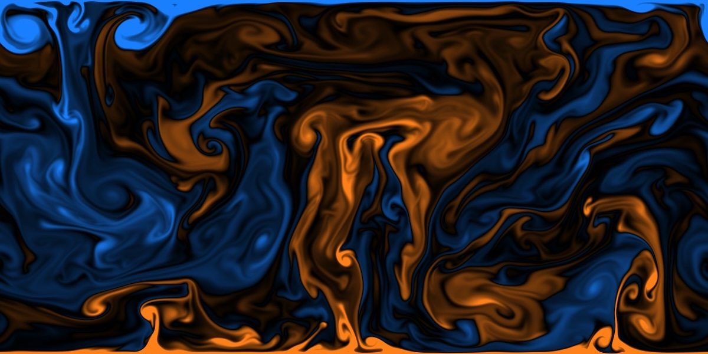

# 2D

Two-dimensional domains, periodic in x, wall-bounded in y.



## Usage

```bash
make output
make all
./a.out
```

The resulting flow fields are written to `output/save` with `NPY` format.
Contour images are dumped to `output/image` with `PPM` format.

